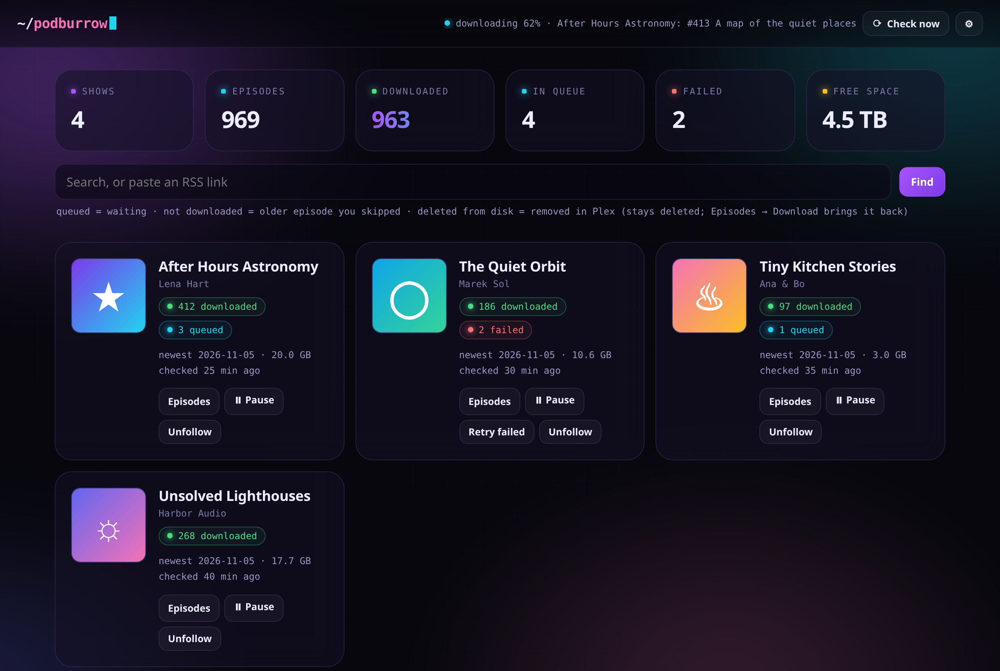
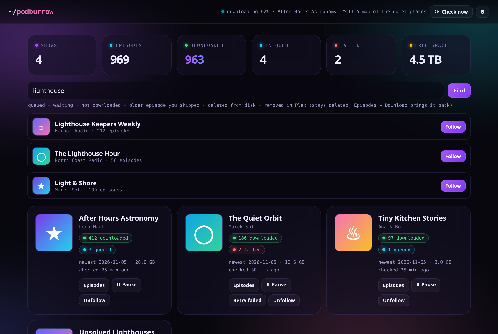
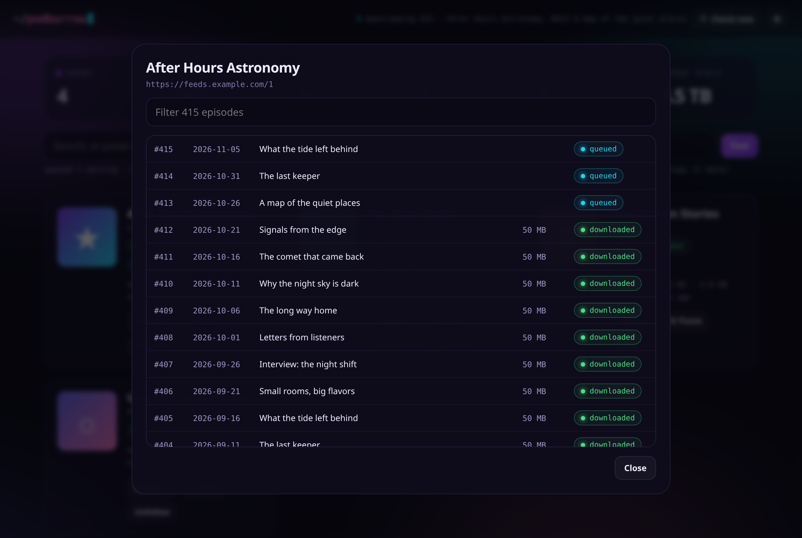
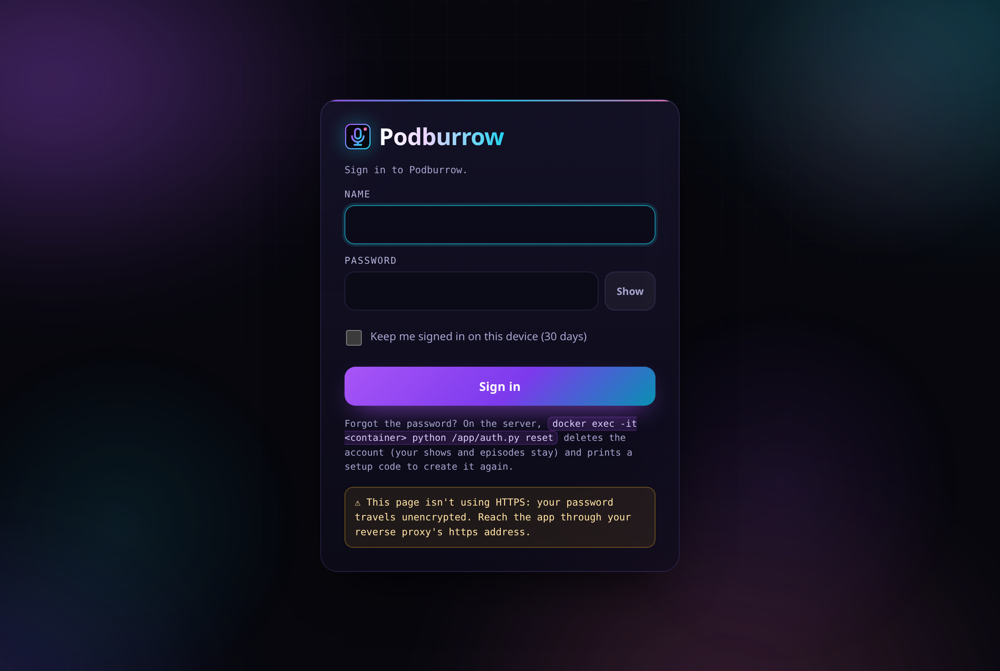
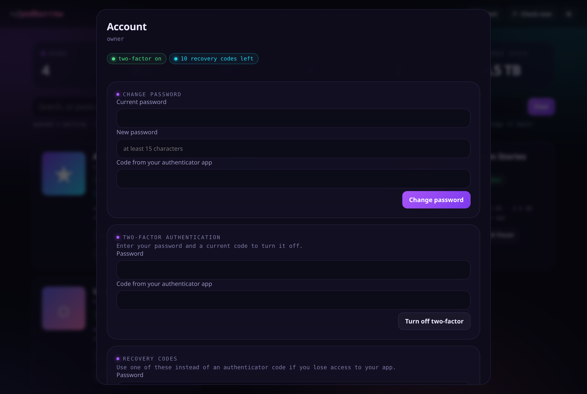
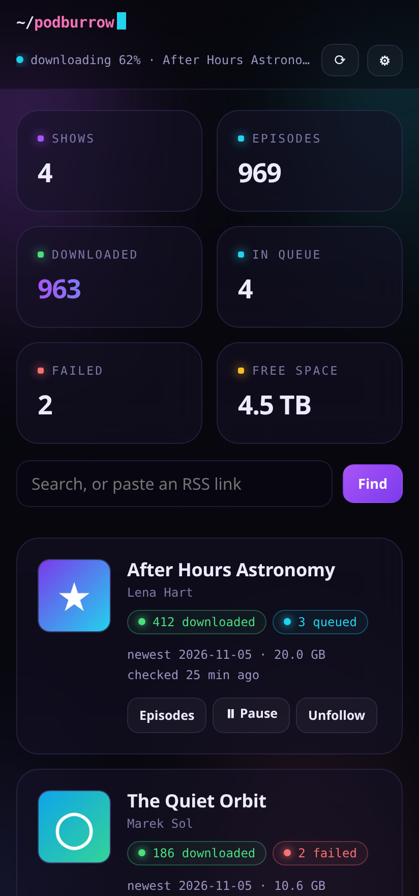

# Podburrow

A self-hosted podcast downloader. It follows your shows and files every episode in a library Plex reads as music.



## Why

Podcast hosts delete old episodes and change links, and a downloader takes files from strangers and puts them on your disk.
Podburrow keeps your own copy, and treats every feed and file as hostile. [See how that was checked](#security).

## Features

- Search by name, or paste an RSS link
- Downloads the whole back catalogue, or only new episodes
- Plex-friendly folders and tags, with one artist per show and one album per year
- Picks up changed download links, and retries failures with growing delays
- Pauses if the drive is missing or nearly full, rather than filling the wrong disk
- Episodes you delete stay deleted
- Built-in sign-in with authenticator codes, or use your reverse proxy's SSO
- Moves your shows and files over from Podgrab
- Runs in a small, read-only, unprivileged container

## Screenshots

| | |
|---|---|
|  |  |
| Find and follow a show | Every episode of a show |
|  |  |
| Built-in sign-in | Two-step codes, recovery codes and sessions |



All screenshots use made-up shows.

## Install

You need Docker with Compose, and a media folder on the drive you want to use.

1. Download [`docker-compose.yml`](docker-compose.yml) and [`.env.example`](.env.example). Rename the second to `.env`.
2. In `docker-compose.yml`, point the commented media volume at your folder, and make sure uid 1000 can write to it and to `./data`.
3. Create the drive marker: `touch /path/to/podcasts/.podcasts-media`. Without it, the app assumes the drive isn't mounted and pauses.
4. In `.env`, set `TZ`, `ALLOWED_HOSTS` (the address you open it at), `ORIGIN` (your public https address, if it has one) and
   `HOME_NAMES` (a hostname for your home's public address, so a feed can't loop back through your router).
5. Start it: `docker compose up -d`
6. Get the setup code: `docker logs podburrow 2>&1 | grep '^SETUP CODE' | tail -n 1`
7. Open the address, type the code, and create your account. Then turn on authenticator codes under **Account**.

Use HTTPS through a reverse proxy for anything beyond your own network.

## Behind an SSO proxy

Set `AUTH=proxy` and `TRUSTED_PROXY` to your proxy's container name, share a Docker network with it, and remove the `ports` section.
Only that proxy can then connect. **The proxy's sign-in becomes your only protection**, so it must cover every path.
If `TRUSTED_PROXY` is missing, Podburrow uses its own sign-in rather than opening up.

## Moving from Podgrab

See [docs/MIGRATING-FROM-PODGRAB.md](docs/MIGRATING-FROM-PODGRAB.md).

## Updating

```sh
docker compose pull
docker compose up -d
```

Your database, covers and episodes stay. Back up `./data` first.

## Security

Security was planned in from the start, not added at the end, but please read this section as it is: no software is perfectly
safe, and this project hasn't had a human security audit.

**How it's built**

- Feeds and audio files are treated as hostile. They're parsed in separate processes with memory and CPU limits.
- Downloads only reach public IPv4 addresses on ports 80 and 443, checked after DNS and on every redirect.
- Nothing works without signing in, except the sign-in page and a health check. Passwords use scrypt, with a common-password
  blocklist, growing waits, and optional authenticator and recovery codes.
- The page refuses inline and outside scripts, and requests from other sites are refused.
- The one dependency is [mutagen](https://github.com/quodlibet/mutagen), pinned by hash. The base image and CI actions are pinned too.

**How it was tested**

- 307 automated tests run on every push, using local servers and mocks. They include hostile feeds, private-address tricks, path
  escapes, a full disk, a missing drive, crashes, forged headers, cross-site requests and the full sign-in flow.
- As a spot check, five security checks were deliberately broken, and the tests caught all five.
- Five independent AI review agents each attacked one area, proving findings with working examples. Two more re-checked the fixes.

**What the reviews found**

They found real bugs, including two rated high: the first image didn't contain the app at all, and a hostile feed host could hang
the download worker. All reported findings were fixed. The full list is in
[docs/SECURITY-REVIEW.md](docs/SECURITY-REVIEW.md).

**What you should know**

- **Written with AI.** The code, tests and reviews were produced with AI models (Claude and DeepSeek), directed by one person.
  AI reviewers can miss things, including the same things the AI authors missed.
- **Not a paid audit.** No human security professional has reviewed it.
- **Some things weren't tested**, including most reverse proxies and running on arm64. They're listed in the review.

Read [THREAT-MODEL.md](THREAT-MODEL.md) for what it does and doesn't defend against, and [TESTING.md](TESTING.md) to run the tests yourself.
To report a problem privately, see [SECURITY.md](SECURITY.md).

## What leaves your server

- Requests to the feeds and hosts you follow
- Search text and artwork requests, sent to Apple's iTunes service when you search

Nothing else. There's no telemetry.

## License

[MIT](LICENSE)
